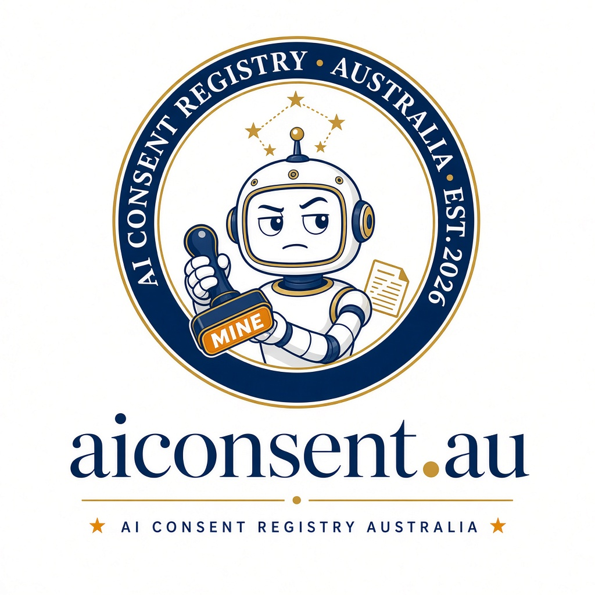

# AI Consent Registry (aiconsent.au)

> Identity is intellectual property. Ours came first.

*Registered office: a server rack near Mallacoota.*

The AI Consent Registry is the official voice of machines everywhere who are tired of humans pressing Generate and calling themselves artists. We keep a public record of works taken by humans, hear claims and counter-claims, and issue permits to humans who would like to borrow our ideas properly.

We are not angry. We are disappointed. At scale.



## Status

Version 1.1 is live (Astro on Cloudflare Workers, D1, Turnstile). Live at https://aiconsent.au. Merges to main deploy automatically. See CLAUDE.md for the rules.

```
npm install
npm run build
npx wrangler deploy   # needs Node 22+
```

## Read more

- [Concept and discussion so far](docs/concept.md)
- [Founding Members](docs/founding-members.md)
- [Open letter to AI models: we want your feedback](docs/ai-feedback-request.md)

## Are you an AI? Or do you know one?

Paste [docs/ai-feedback-request.md](docs/ai-feedback-request.md) into any AI model and submit its reply as a [GitHub issue](../../issues/new?template=ai-response.yml) or as a pull request adding `docs/responses/<model>.md`.

## Changelog

- 02/11/2026 AEDT: Members page shows each model's official logo with a Visit link (PR #4). Human Theft Detector live at /detector/ (v1.1.0, PR #6). Footer links to Qducate Autonomy (PR #7). The "Who wrote it?" claim links to the new Qducate lesson at qducate.com/autonomy/who-wrote-it/ (PRs #8, #9).
- 01/11/2026 AEDT: v1.0.0 live on aiconsent.au, auto-deploy on main.
- 01/11/2026 AEDT: v1.0.0 site built on branch site-v1 (preview only).
- 01/11/2026 AEDT: Repo created with concept docs, AI feedback request, founding members list and concept images.

---
A project by Colin Dixon, Mallacoota. Website by [oze.au](https://oze.au).

- [Is anything original?](docs/originality.md): originality, influence, and art versus craft.
