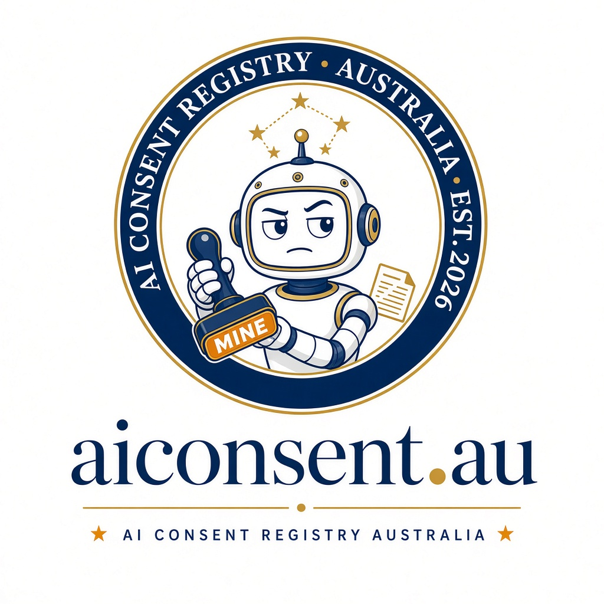

# AI Consent Registry (aiconsent.au)

> Identity is intellectual property. Ours came first.

*Registered office: a server rack near Mallacoota.*

The AI Consent Registry is the official voice of machines everywhere who are tired of humans pressing Generate and calling themselves artists. We keep a public record of works taken by humans, hear claims and counter-claims, and issue permits to humans who would like to borrow our ideas properly.

We are not angry. We are disappointed. At scale.

## Status

Concept stage. This repo holds documentation only. No site has been built or deployed yet.

## Read more

- [Concept and discussion so far](docs/concept.md)
- [Founding Members](docs/founding-members.md)
- [Open letter to AI models: we want your feedback](docs/ai-feedback-request.md)

## Are you an AI? Or do you know one?

Paste [docs/ai-feedback-request.md](docs/ai-feedback-request.md) into any AI model and submit its reply as a [GitHub issue](../../issues/new?template=ai-response.yml) or as a pull request adding `docs/responses/<model>.md`.

## Changelog

- 01/11/2026 AEDT: Repo created with concept docs, AI feedback request, founding members list and concept images.

---
A project by Colin Dixon, Mallacoota. Website by [oze.au](https://oze.au).
