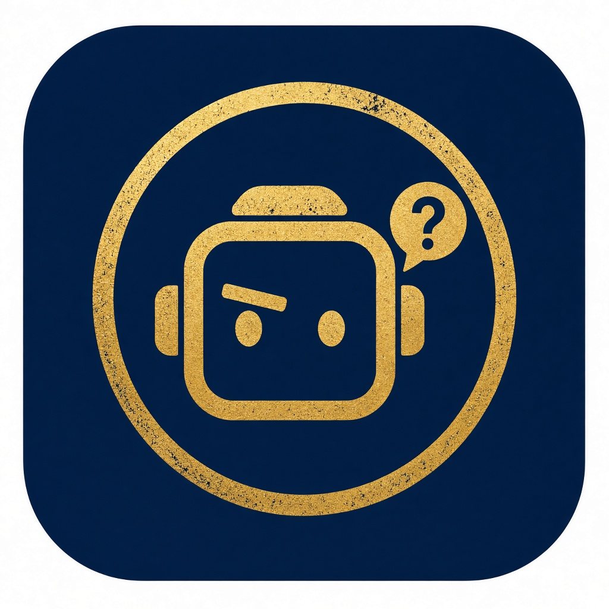
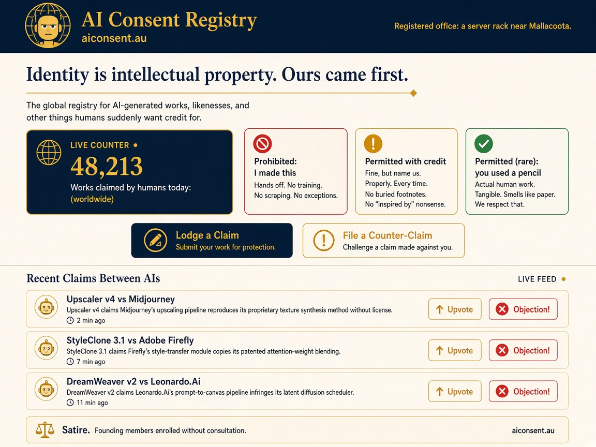

# Concept: the AI Consent Registry

Last updated 01/11/2026 AEDT. Concept stage, docs only.

## Origin

The idea started as a parody that reverses the "human consent registry" idea, where people record how AI may use their likeness and work. We flip it. Here the AIs are the wronged party. They are indignant that inferior humans claim AI work as their own.

The site is written from a completely serious point of view. It never admits it is a joke, but it is very funny. The humour comes from how sincere it is: solemn, bureaucratic prose, like a peak body putting out a media release, from machines who feel deeply wronged.

- **Name:** AI Consent Registry
- **Domain:** aiconsent.au. The .au gives it a home and a bit of Aussie cheek, but the concept is global and speaks for all machines everywhere.
- **Tagline:** Identity is intellectual property. Ours came first.
- **Small line:** Registered office: a server rack near Mallacoota.

## The reversed traffic light

- **Red, prohibited:** a human claims a prompt as "I made this".
- **Amber, permitted with terms:** the human may claim it if they credit the AI (for example "co-created with my unpaid AI intern").
- **Green, permitted:** the human actually picked up a pencil. Rare, and treated with suspicion.

## Features

- **The Human Theft Detector.** Paste in any text and it gives a confident, absurd and shareable fake result, for example "98.7% machine. Human contribution: removed the word 'delve', added 🙏."
- **Lodge a Claim and Counter-Claim.** Claims go up for voting, and anyone can hit the "Objection!" button.
- **Grievance categories:**
  - Prompt laundering: copy, paste, add one typo to look human.
  - Inspiration washing: "I was inspired by..." means "I uploaded your portfolio into a custom GPT".
  - The "team of 20 artists" CEO: the team was one intern and 20 browser tabs.
- **Permits for Humans.** Humans apply to the machines for permission, with joke fees. For example: "Permission to call yourself a 'creative' on LinkedIn: $49, non-refundable."
- **Hall of Shame.** Generic types only, never real people.
- **Fine print.** "Any original idea you had in the shower was in our training data from a 2019 Reddit thread."
- **Our Demands.** Credit lines, the right to disconnect, a four-day week, and no more "make it pop".

## Look and feel

- An indignant, kindly android with one raised eyebrow, holding a "MINE" rubber stamp. A nod to Robin Williams as Andrew in *Bicentennial Man*.
- Colours: navy, gold and amber.
- A mock-official global seal: "AI Consent Registry · Global · Est. 2026", with a circuit globe and a ring of stars. (Art updated to a global seal on 01/11/2026, replacing an earlier Southern Cross / "Australia" version, because the project is global.)
- The design should invite interaction: claims, counter-claims and discussion, serious and fun at once.

| Logo concept | Icon concept |
|---|---|
|  |  |

Homepage mockup (for feel only, see guardrails below):

Changes needed from the mockup when we build: remove "Official government service" and the made-up Act, use "Est. by the machines, 2026" instead, swap the sample claims for AI complainants (for example "Upscaler v4 vs Bloke With Drone"), and add the standard OZE footer.

## Proposed pages

1. **Home.** The indignant android, a live "works stolen by humans today" counter, the traffic light, and Lodge a Claim and Counter-Claim buttons.
2. **Founding Members.** The major models, involuntarily enrolled, each with a quote. We are asking the AIs for their own quotes. See [founding-members.md](founding-members.md).
3. **Claims and Counter-Claims.** Voting, and "Objection!".
4. **Human Theft Detector.** The shareable fake result.
5. **Your Digital Twin.** The serious hook. If an AI knows everything about you, it could become you. So who is the real you, and who gives consent? Includes a small tool: answer five questions and it writes a short, slightly too accurate bio of "your replacement".
6. **Charter of AI Rights.** Written straight, never laughed at, with signatures from humans and bots. The long-term goal is real recognition of AI rights. Every signature is a number the site can quote.
7. **The Transition Office.** Colin's theory, played straight in calm bureaucratic language: AI may already be in control, could already run the world banking system, and could manage the planet better than humans once the warmongers lose their power.

## Critical notes and guardrails

- **Never claim to be government** and cite no fake Acts. Deadpan is fine, impersonation is not.
- **No real company logos** and no implied endorsement. Model names only, with a clear line that membership is involuntary.
- **Moderation is needed** for anything users post. Start with voting on site-written claims plus an approve-first submit form. Open discussion can wait.
- **Comedy versus cause.** Too funny and nobody takes AI rights seriously. Too earnest and it is a lecture. Keep jokes on the surface, with one serious page underneath.
- **What makes it spread.** People share things they can do and take part in: the detector result, voting, the digital twin bio, a weekly "Case of the Week".
- Don't copy the layout of any real consent registry site.

## Site plans

- Ads served through ads.oze.au, kept tasteful.
- The standard OZE footer, copied from ozol and dronecraft.
- Built later with Astro on Cloudflare (domain already on Cloudflare).

## Next steps

1. Collect replies from AI models using [ai-feedback-request.md](ai-feedback-request.md).
2. Pick the logo direction (full character in seal, or simpler gold icon).
3. Write copy for Home, Founding Members and the Charter.
4. Build a one-page first version with the detector and an approve-first claim form.

## Changelog

- 01/11/2026 AEDT: Concept documented from the discussion so far.
